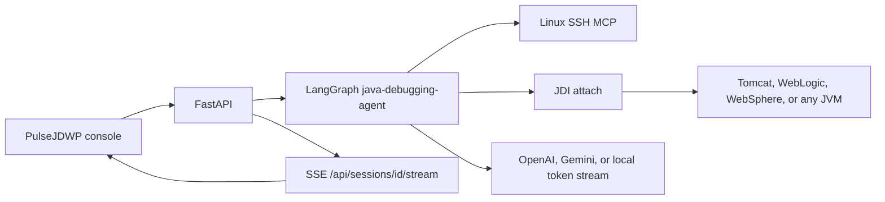

# PulseJDWP java-debugging-agent

Remote Java JDWP debugging agent and operator console. A LangGraph session reads a stack trace, asks the pawangunjkar Linux SSH MCP where the JVM debug port is, waits for a human gate before any startup-script edit, then attaches with the JDK debugger and streams the diagnosis to the operator console.

## Project

| | |
| --- | --- |
| Name | pulse-jdwp-java-debugging-agent |
| Owner | Pawan Gunjkar |
| Email | pawangunjkar@gmail.com |
| GitHub | Pawangunjkar |
| Runtime | Python 3.11+, FastAPI, LangGraph, React |

## Architecture



## Run

```bash
cd pulse-jdwp
uv sync
uv run uvicorn backend.main:app --host 127.0.0.1 --port 8099
```

```bash
cd pulse-jdwp/frontend
npm install
npm run dev
```

Open http://127.0.0.1:5173. There is no sign-in screen.

`JDWP_SIMULATE=true` in `.env.example` lets the console stream a diagnosis without a remote JVM. Point `SSH_MCP_COMMAND` at `linux-ssh-mcp` when you want real startup-script inspection. Script writes stay behind the Human Queue.

Sessions are written to `data/pulse-state.json` and stay available after a restart. `JDWP_SIMULATE=false` attaches to a live JDWP port. The sample under `samples/checkout` is the standalone Java application used to verify Tomcat, WebLogic, and WebSphere startup-script discovery.
